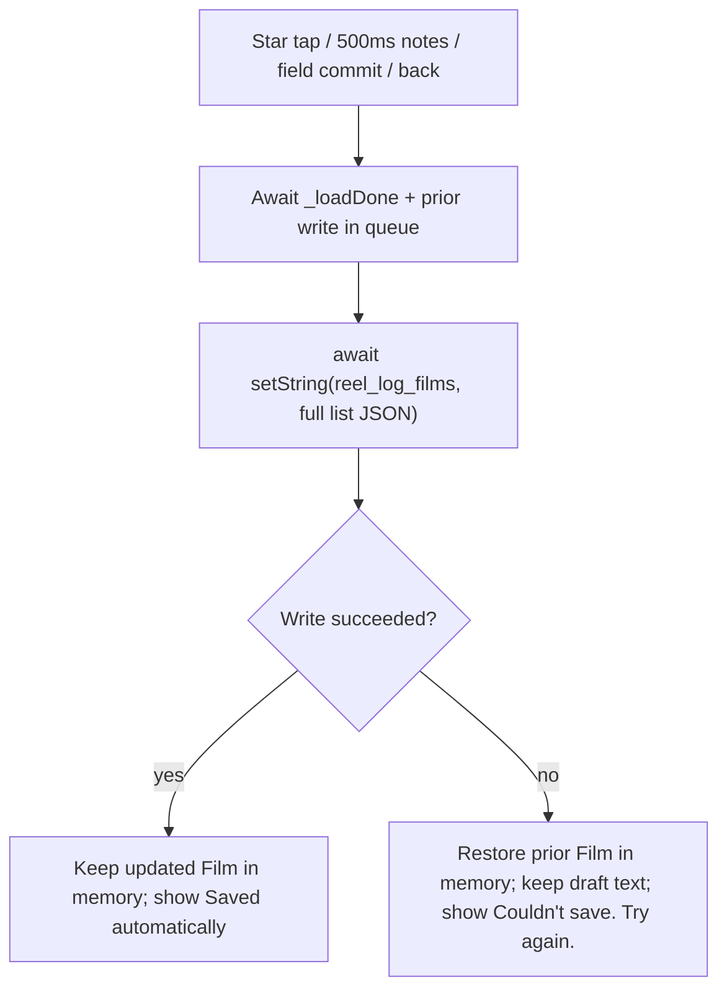
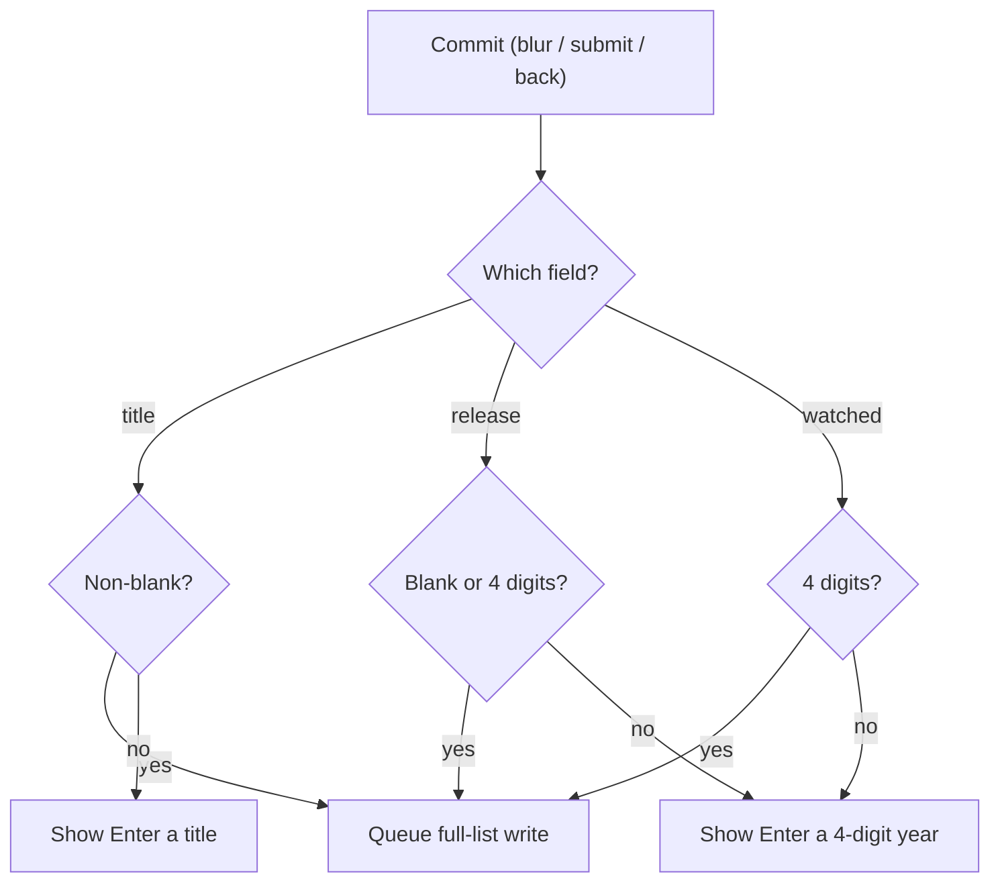

# Design

## Context

See proposal.md for why. The app is a single file, `lib/main.dart`. `_ReelLogHomeState` holds `_films` in memory, replaces it from `SharedPreferences` key `reel_log_films` once `_loadOrSeed` completes, and rewrites the full JSON list on save. `_row` currently has no tap handler. Unlike `_LogSheet`, which validates and writes once when Save is tapped, the detail screen saves ratings on tap and autosaves text edits without a Save button.

Handoff `02 Film detail` ([issue #2](https://github.com/redge-aw/reel_log/issues/2)) shows a `< Watched` back bar, 112x168 poster tile, title and release year, `Your rating` card (`Not rated` or `X of 5`, five 44x44 star targets, `Watched <year>`), and `Notes` with `Saved automatically`. Only `title`, `year`, `watchedYear`, `rating`, and `notes` are modeled on `Film`, so `director`/`runtime`/`genre` and `Share`/`Remove` are omitted.

## Goals / Non-Goals

**Goals:**

- Meet `specs/film-detail/spec.md` inside `lib/main.dart` and `test/widget_test.dart`, with no new packages.
- Keep the same widget-per-surface pattern as `_LogSheet`.
- Prevent overlapping saves or fast back-navigation from dropping edits.

**Non-Goals:**

- Share flow (screen 04) or Remove flow (screen 01 with toast).
- Adding `director`, `runtime`, or `genre` to `Film`.
- Introducing separate store or session wrapper classes.

## Decisions

### D1 Detail is its own `StatefulWidget` in `lib/main.dart`, pushed from `_row`

Tapping a row pushes a private detail widget with the film's `id` and an update callback from `_ReelLogHomeState`. Like `_LogSheet`, keeping the detail form in its own `StatefulWidget` scopes its text controllers, focus nodes, and debounce timer to the route's lifetime. `_ReelLogHomeState` owns `_films`, `_query`, and `_filter`, so updating `_films` in place refreshes the list and average while preserving search and filter state on back. If the `id` is missing after `_loadDone` completes, the route shows `Film not found.` and pops.

Alternative: pass a `Film` copy and return the edited value only on pop. Rejected because ratings and notes must persist while the detail screen is still open.

### D2 Serialize writes in `_ReelLogHomeState` and flush on back before popping

Because the detail screen can trigger a star-tap write while a 500ms notes debounce write is already in flight, `_ReelLogHomeState` chains writes sequentially after `_loadDone`, resolving a fresh `SharedPreferences.getInstance()` per write.

In the detail widget, typing notes restarts a 500ms timer. Because Flutter's `State.dispose()` is synchronous and cannot `await` a write or block navigation on error, `dispose()` only cancels the timer and disposes controllers/focus nodes. Instead, back navigation (`PopScope` and the `< Watched` button) cancels any pending timer, commits dirty valid fields, and awaits the write before popping.

Alternative: fire-and-forget writes per keystroke or flushing inside `dispose()`. Rejected because overlapping full-list writes race, and `dispose()` cannot keep the route open if a flush fails.

### D3 Validate title and years on commit (blur, submit, or back), not per keystroke

Title, release year, and watched year are always-visible inputs so even a film saved with `year == null` has an empty release-year field ready to edit. Validation runs when a field loses focus, is submitted, or when the user navigates back — never on a mid-typing timer. Invalid input shows the same inline error copy as `_LogSheet` (`Enter a title.`, `Enter a 4-digit year.`), keeps the user's draft text in the field, and skips writing that field. A valid title commit updates the poster tile's initials immediately.

Alternative: validate on every keystroke or after an 800ms typing pause. Rejected because pausing at two digits (`"20"`) while retyping a year would flash `Enter a 4-digit year.` mid-edit.

### D4 Sticky rating and write-failure rollback

Unlike `_LogSheet`, where tapping the current star clears the rating to `0`, detail stars are sticky: tapping any star `1..5` always sets that rating (`0` shows all outline stars and `Not rated`; `1..5` shows `$rating of 5`).

If a write throws, `_ReelLogHomeState` restores the previous `Film` in memory and rethrows. On a star tap, the detail widget reverts the displayed stars and label to the previous rating; on a text field, the controller keeps the typed draft text so work is not lost. Both show `Couldn't save. Try again.` inline, and a failed back-flush keeps the detail route open.

### D5 Detail presentation

Matches `02 Film detail` (`Reel Log - Film detail.html`): `< Watched` top bar (height 52, primary chevron + label), 112x168 poster tile (radius 8, 22px w700 initials from `_tones[id % 5]`) beside the title (24px w700) and release-year (4-digit numeric) inputs, `Your rating` card (fill `0xFFF3F3F6`, border `0xFFDBE5E0`, radius 12, padding 16) containing the rating header, five 32px stars in 44x44 targets (`'1 of 5'`…`'5 of 5'` tooltips), and the watched-year input, followed by `Notes` (5-line field with placeholder `'What stayed with you?'`) and the `Saved automatically` / `Saving...` caption. Detail fields carry keys `detailBack`, `detailTitle`, `detailReleaseYear`, `detailWatchedYear`, and `detailNotes` for tests.

## Risks / Trade-offs

- [Full-list rewrite per tap or commit] → Accepted at local demo scale; 500ms notes debounce and serialized writes bound the frequency.
- [Editing `watchedYear` reorders the list on back] → Expected: `_visible` sorts by `watchedYear` descending.
- [Always-visible inputs for title and years differ slightly from static header text in the prototype] → Chosen intentionally so all modeled fields can be edited inline, including adding a release year when `year == null`.

## Migration Plan

No store migration needed. Detail reads and writes the existing `reel_log_films` JSON format.

## Open Questions

None.
