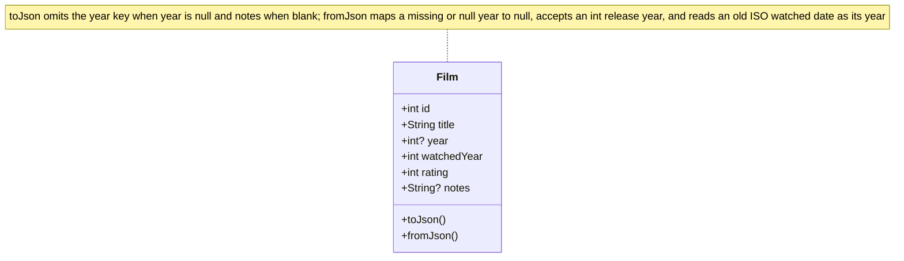
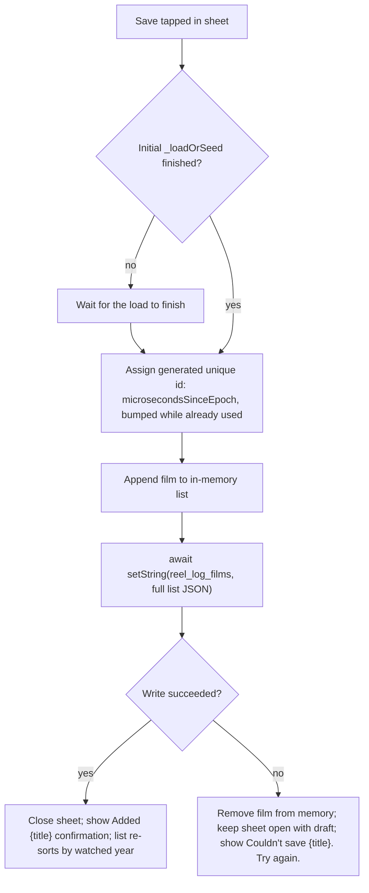

# Design

## Context

See proposal.md for why. The app is one file, `lib/main.dart`. `Film.year` is a required `int`. The list in memory starts as the demo seed, then `_loadOrSeed` replaces it from `SharedPreferences` key `reel_log_films` when that key exists. `_visible` already sorts by `watched` descending and the average ignores `rating == 0`. The log button's `onPressed` is empty. There is no director field.

## Goals / Non-Goals

**Goals:**

- Meet `specs/log-film/spec.md` inside the current file and test, with no new package.
- Store a blank release year as absent, not as a guessed year.
- Confirm only after the full list has been written.

**Non-Goals:**

- Editing a film already in the list.
- Copying either exploratory worktree.
- Changing poster initials.
- A lock or migration for ids already on disk.

## Decisions

### Sheet is its own widget in `lib/main.dart`

The form holds text controllers and a rating. A private `StatefulWidget` disposes those controllers when the sheet closes. An inline builder in the parent would keep that state in the list widget for the whole session.

Alternative: a new library file. The app is still one screen, so a second file only moves the same widget.

### `Film.year` becomes `int?`

Blank input saves `year: null` and omits `year` from JSON. `fromJson` treats a missing or null year as null and still accepts an int from older saves. The row prints the year only when it is non-null. Do not substitute the watched year or the current year.

Alternative considered: store `0` or the watched year. Both make a blank field look like a real release year.

### Watched is a year, not a date

`Film.watched` (`DateTime`) becomes `watchedYear` (`int`). A person logging a film remembers the year they saw it, not the exact date, so the sheet asks for a year. The sheet's watched-year field is digits only, length 4, defaulting to the current calendar year. The row shows the watched year instead of a formatted date, `_visible` sorts by `watchedYear` descending (order within the same year is unspecified), and the `2026` filter compares `watchedYear`. In JSON the watched year is stored as an int; `fromJson` also accepts the old ISO date string and takes its year, so existing saves keep loading.

Alternative considered: keep the full date and make month/day optional. That keeps a precision most entries will never have and complicates sorting and display for no caller.

### Notes are absent when blank

`Film.notes` becomes `String?`. Blank sheet notes save as `null` and are omitted from JSON, the same "store blank as absent" rule as the release year. `fromJson` treats missing notes as null. The With-notes filter treats null as no notes.

Alternative considered: keep `''` for blank. Two representations of "no notes" (empty string vs absent) is exactly what the release-year decision removed.

### Id is a generated unique identifier, chosen at save time

The new id is generated at the moment of save from the current time (`DateTime.now().microsecondsSinceEpoch`), bumped by one while it collides with an id already in the in-memory list. It is not derived from the existing ids, so no max computation is needed. If `_loadOrSeed` has not finished, the save still waits for it before appending — not for the id, but because the load replaces the in-memory list and would drop the appended film.

Alternative: id chosen when the sheet opens. Uniqueness does not need it, and a draft id invites callers to depend on an id before the film exists.

### Write, then confirm

Append the film, await `setString` of the full list in the same JSON shape `_loadOrSeed` already writes, then close the sheet and show `Added "{title}"`. If the write throws, drop the film from memory, keep the sheet open with the draft as entered so Save can be tapped again, and show `Couldn't save "{title}". Try again.` The existing sort is unchanged in shape, so a film from an earlier watched year slots in by `watchedYear`.

### Sheet presentation

`showModalBottomSheet`, top radius 28, 300ms ease-out on open and close. Title, release year, watched year, and notes use the existing field style. Both year inputs are digits only, length 4; the watched year defaults to the current calendar year. Stars are buttons with a tooltip; tapping the current rating sets it back to 0.

Validation copy is inline and exact. The sheet tracks whether the title field has been interacted with; once it has, an empty or whitespace title shows `Enter a title.` under the field, clearing when the title gains non-whitespace text (Save stays disabled either way). Save is gated by the title alone: tapping Save with a non-blank year that is not exactly four digits — or a cleared watched year — shows `Enter a 4-digit year.` under that field and does not save. The sheet tracks that year error per field from the last save attempt.

### Tests live next to the existing widget test

Extend `test/widget_test.dart`. Cover the spec scenarios that the list can assert without a device: disabled Save, four-digit cap, unrated save leaving the average unchanged, toggle-off, a saved non-zero rating, Cancel leaving the store unchanged, an earlier watched year below a later one, and no `director` key. The full requirement-by-requirement checklist lives in `tasks.md`.

## Risks / Trade-offs

- [Save during the first load can still race if two saves overlap] → One sheet at a time is enough for this app. The load wait covers the startup window. A second overlapping save is not guarded.
- [A year of `0007` parses to `7`] → The field is an int. The spec only caps length and digits.
- [Watched year loses ordering within a year] → Accepted: exact watched dates were the thing the review removed. Films in the same watched year sort in an unspecified order.
- [Two saves in the same microsecond could collide] → The generated id is bumped while it matches an existing id, so a collision becomes the next integer.
- [Confirmation still depends on the write completing in-process] → A kill between append and `setString` can lose the new film. Acceptable for local demo storage.
- [Corrupt prefs stay on disk until a successful save] → A successful save replaces them with the seed plus the new film, which is what the screen was already showing. Leave that as-is.

## Migration Plan

No store migration write. `fromJson` reads older entries in place: int ids unchanged, an ISO watched date string becomes its year, missing notes become null, and an ignored `director` key on old JSON is left unread. Rollback is reverting the app; new entries (watched stored as an int year, or no release year) would fail to load on the old build.

## Open Questions

None.
