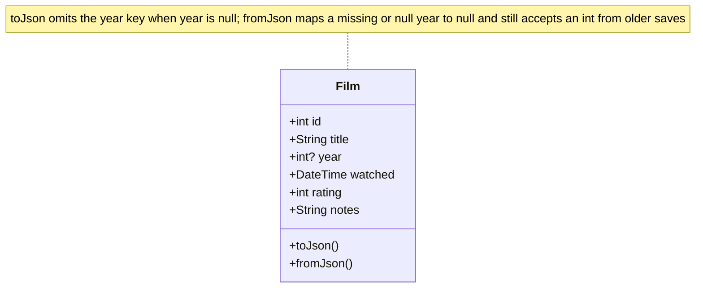
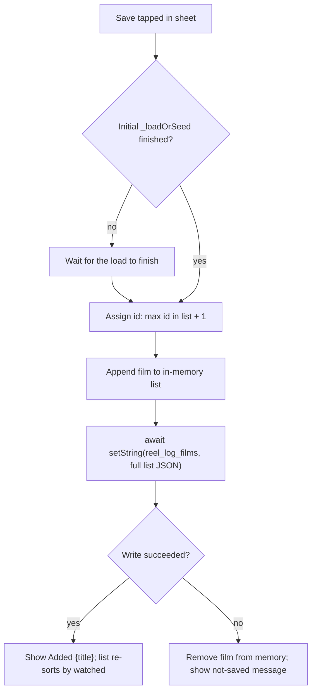

# Design

## Context

See proposal.md for why. The app is one file, `lib/main.dart`. `Film.year` is a required `int`. The list in memory starts as the demo seed, then `_loadOrSeed` replaces it from `SharedPreferences` key `reel_log_films` when that key exists. `_visible` already sorts by `watched` descending and the average ignores `rating == 0`. The log button's `onPressed` is empty. There is no director field.

## Goals / Non-Goals

**Goals:**

- Meet `specs/log-film/spec.md` inside the current file and test, with no new package.
- Store a blank release year as absent, not as a guessed year.
- Confirm only after the full list has been written.

**Non-Goals:**

- Editing a film already in the list.
- Copying either exploratory worktree.
- Changing poster initials.
- A lock or migration for ids already on disk.

## Decisions

### Sheet is its own widget in `lib/main.dart`

The form holds text controllers and a rating. A private `StatefulWidget` disposes those controllers when the sheet closes. An inline builder in the parent would keep that state in the list widget for the whole session.

Alternative: a new library file. The app is still one screen, so a second file only moves the same widget.

### `Film.year` becomes `int?`

Blank input saves `year: null` and omits `year` from JSON. `fromJson` treats a missing or null year as null and still accepts an int from older saves. The row prints the year only when it is non-null. Do not substitute the watched year or the current year.

Alternative considered: store `0` or the watched year. Both make a blank field look like a real release year.

### Id is chosen at save time, after the initial load

The new id is one greater than the max id in the in-memory list at the moment of save. If `_loadOrSeed` has not finished, the save waits for it, then computes the id. That avoids assigning an id from the seed and then appending it onto a loaded list that already uses that id.

Alternative: id chosen when the sheet opens. That is the wider race, because the load can finish while the sheet is open.

### Write, then confirm

Append the film, await `setString` of the full list in the same JSON shape `_loadOrSeed` already writes, then show "Added {title}". If the write throws, drop the film from memory and tell the person it was not saved. The existing sort is unchanged, so a backdated film slots in by `watched`.

### Sheet presentation

`showModalBottomSheet`, top radius 28, 300ms ease-out on open and close. Title, year, and notes use the existing field style. Year input is digits only, length 4. Date watched opens the platform date picker, initially today, from 1900 through 2100. Stars are buttons with a tooltip; tapping the current rating sets it back to 0.

### Tests live next to the existing widget test

Extend `test/widget_test.dart`. Cover the spec scenarios that the list can assert without a device: disabled Save, four-digit cap, unrated save leaving the average unchanged, toggle-off, a saved non-zero rating, Cancel leaving the store unchanged, a backdated film below a later one, and no `director` key.

## Risks / Trade-offs

- [Save during the first load can still race if two saves overlap] → One sheet at a time is enough for this app. The load wait covers the startup window. A second overlapping save is not guarded.
- [A year of `0007` parses to `7`] → The field is an int. The spec only caps length and digits.
- [Confirmation still depends on the write completing in-process] → A kill between append and `setString` can lose the new film. Acceptable for local demo storage.
- [Corrupt prefs stay on disk until a successful save] → A successful save replaces them with the seed plus the new film, which is what the screen was already showing. Leave that as-is.

## Migration Plan

No store migration. Older entries keep their year. An ignored `director` key on old JSON is left unread. Rollback is reverting the app; new entries without a year would fail to load on the old build.

## Open Questions

None.
